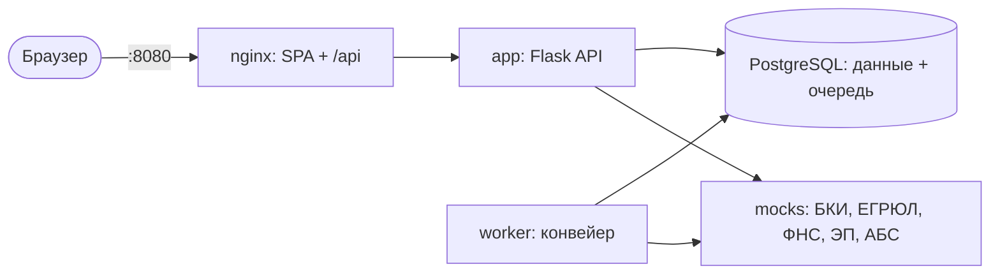

# Умный кредитный кабинет предпринимателя

Прототип цифрового кредитного конвейера для малого и микробизнеса. Трек «Умный кредитный кабинет предпринимателя», Альфа-Будущее Хакатон 2026.

Предприниматель, который уже обслуживается в банке, подбирает кредит, подаёт заявку с предзаполненными данными компании и видит, как она проходит проверку. Он отвечает на дозапросы, получает предложение с объяснением решения и подписывает договор кодом в интерфейсе. Кредитный аналитик в том же приложении рассматривает пограничные заявки.

> **Все данные синтетические.** Компании, люди и ИНН вымышлены: в ИНН и ОГРН используется несуществующий код региона `00`. Бюро кредитных историй, ЕГРЮЛ/ЕГРИП, ФНС «Прозрачный бизнес», электронная подпись и АБС заменены моками в контейнере `mocks`. Реальные системы банка не вызываются, email и SMS не используются.

## Быстрый старт

Нужно: Docker Desktop или Docker Engine с Compose v2, 8 ГБ ОЗУ, свободные порты 8080 и 8001. GPU, Python, Node.js и файл `.env` не нужны.

```bash
git clone <ссылка на репозиторий>
cd <каталог репозитория>
docker compose up --build
```

Первый запуск скачивает базовые образы и собирает приложение — обычно 3–5 минут. Когда все сервисы перейдут в состояние `healthy` (`docker compose ps`), откройте:

| Что | Адрес |
| --- | --- |
| Приложение | http://localhost:8080 |
| Swagger UI | http://localhost:8080/api/docs |
| Моки внешних систем | http://localhost:8001 (например, `/egrul/0044385397`) |

При старте `app` сам применяет миграции и загружает демо-данные, если база пустая.

Если порт 8080 или 8001 занят:

```bash
NGINX_PORT=8088 MOCKS_PORT=8002 docker compose up --build     # bash
$env:NGINX_PORT=8088; docker compose up --build              # PowerShell
```

## Как проверить: пять сценариев

Вход без паролей: на странице входа выберите компанию. Сменить профиль или выйти можно в любой момент в шапке.

| Профиль | Компания | Что ввести | Что получится |
| --- | --- | --- | --- |
| `demo-approve` | ООО «Тёплый колос» | «Ритм», 3 000 000 ₽, 24 мес. | предложение на ваших условиях → подпись кодом → выдача |
| `demo-counter` | ООО «Дальний рейс» | «Ритм», 12 000 000 ₽, 24 мес. | контрпредложение: 9 910 000 ₽ на 36 мес. |
| `demo-info` | ИП Лаврова М. О. | цель «оборудование», «Станок», 2 500 000 ₽, 36 мес., без данных о залоге | дозапрос → ответ в кабинете → предложение |
| `demo-manual` | ООО «Зелёная веранда» | «Быстрый старт», 1 500 000 ₽, 18 мес. | ручное рассмотрение → решение аналитика |
| `demo-reject` | ООО «Кромка-Строй» | «Ритм», 2 000 000 ₽, 12 мес. | отказ: текущая просрочка 120 дней |
| `analyst` | Кредитный аналитик | — | очередь, карточка заявки, решения |

Пошагово, с ожидаемыми экранами: [`docs/test-scenarios.md`](docs/test-scenarios.md). Те же сценарии через API — Postman-коллекция [`postman/credit-cabinet.postman_collection.json`](postman/credit-cabinet.postman_collection.json): импортируйте её и запустите папки 1–5 Runner'ом.

Что ещё стоит попробовать:

- **Сбой внешней системы.** `curl "http://localhost:8001/admin/fail?service=bki"`, затем отправьте заявку: после трёх попыток она уйдёт аналитику с причиной «БКИ не ответило». Включить обратно: `…&enabled=false`.
- **Свои синтетические данные.** `docker compose run --rm app flask seed --generate 50 --gen-seed 42`: на странице входа появится список сгенерированных компаний, моки ответят им по хешу ИНН.

## Что умеет

**Предприниматель**

- подбор 1–3 продуктов под цель, сумму и срок с предварительной ставкой и платежом;
- заявка с предзаполненными данными компании, проверкой полноты и сохранением черновика;
- трекер: статус, этапы проверки (ЕГРЮЛ, ФНС, БКИ, скоринг, решение), пояснение «что происходит и что делать»; статус обновляется сам каждые 2 секунды;
- ответ на дозапрос банка в кабинете;
- предложение: условия, график платежей, 3–5 факторов решения простыми словами, принять или отклонить;
- подпись кодом, который показывается на странице, и выдача (обе с плашкой «Симуляция»);
- центр уведомлений в шапке.

**Кредитный аналитик**

- очередь заявок с фильтром по статусу;
- карточка: данные компании и обороты, ответы ЕГРЮЛ/ФНС/БКИ, все 9 факторов скоринга с баллами, стоп-факторы, рекомендация движка, история решений, журнал;
- решение по ручному рассмотрению: одобрить, изменить условия, запросить информацию или отказать; комментарий обязателен.

## Архитектура



| Сервис | Назначение |
| --- | --- |
| `nginx` | отдаёт собранный SPA (React + TypeScript) и проксирует `/api` в `app` |
| `app` | REST API на Flask + flask-smorest под Gunicorn; миграции и сид при старте |
| `worker` | конвейер: забирает задачи из `pipeline_jobs` (`SKIP LOCKED`), ходит в моки, считает скоринг и решение, выдаёт кредит |
| `db` | PostgreSQL 16: данные и очередь задач |
| `mocks` | синтетические ответы внешних систем по ИНН, сбои по запросу |

Решение принимается детерминированными правилами: стоп-факторы → полнота данных → скоринговая карта из 9 факторов → грейд A–E → условия. Ставка = ключевая ставка (`KEY_RATE`) + спред продукта + надбавка за грейд, платёж аннуитетный. Подробнее: [`docs/architecture.md`](docs/architecture.md), [`docs/scoring.md`](docs/scoring.md), [`docs/state-machine.md`](docs/state-machine.md).

## Переменные окружения

Все переменные имеют значения по умолчанию в `docker-compose.yml`, поэтому `.env` не нужен. Чтобы изменить значение, скопируйте `.env.example` в `.env`.

| Переменная | По умолчанию | Назначение |
| --- | --- | --- |
| `APP_CONFIG` | `prod` | класс конфигурации: `prod`, `dev`, `test` |
| `SECRET_KEY` | демо-значение | ключ подписи токенов; для `docker-compose.prod.yml` обязателен свой |
| `TOKEN_MAX_AGE_S` | `86400` | время жизни токена демо-входа, с |
| `LOG_LEVEL` | `INFO` | уровень JSON-логов |
| `POSTGRES_USER` / `POSTGRES_PASSWORD` / `POSTGRES_DB` | `credit` | параметры БД (наружу порт не открыт) |
| `NGINX_PORT` | `8080` | порт приложения на хосте |
| `MOCKS_PORT` | `8001` | порт моков на хосте (для отладки) |
| `KEY_RATE` | `14.0` | ключевая ставка ЦБ, % годовых (на 23.10.2026) |
| `PIPELINE_STEP_DELAY_MS` | `700` | задержка шагов конвейера, чтобы на демо было видно движение статуса |
| `PIPELINE_HEARTBEAT_TIMEOUT_S` | `60` | через сколько секунд без heartbeat задача возвращается в очередь |
| `PIPELINE_MAX_ATTEMPTS` | `3` | попыток на задачу, затем заявка уходит аналитику |
| `PIPELINE_RETRY_BACKOFF_S` | `5` | пауза между попытками, умножается на номер попытки |
| `ADAPTER_TIMEOUT_S` | `3` | таймаут запроса к внешней системе |
| `ADAPTER_RETRIES` | `2` | ретраев запроса к внешней системе |
| `MOCKS_FAILURE_RATE` | `0` | доля случайных ответов 503 от моков, 0..1 |
| `LLM_ENABLED` | `false` | LLM не используется; основной сценарий от неё не зависит |

## Команды

| make | Без make (Windows и т. п.) | Что делает |
| --- | --- | --- |
| `make up` | `docker compose up --build -d` | собрать и запустить стек |
| `make down` | `docker compose down -v` | остановить и удалить данные |
| `make logs` | `docker compose logs -f` | логи всех сервисов |
| `make test` | `docker compose run --rm --build app pytest` | автотесты (unit + API) против отдельной тестовой БД |
| `make e2e` | `cd frontend && npm ci && npx playwright test` | пять UI-сценариев против поднятого стека |
| `make seed` | `docker compose run --rm app flask seed --reset` | пересоздать демо-данные |
| `make openapi` | см. `Makefile` | выгрузить `docs/openapi.yaml` и перегенерировать типы фронтенда |
| `make lint` | см. `Makefile` | ruff + mypy, eslint + tsc + prettier |
| `make audit` | см. `Makefile` | pip-audit и npm audit |
| `make lock` | см. `Makefile` | пересобрать `requirements*.txt` с хешами (pip-compile) |

Необязательный оверрайд с лимитами ресурсов (стек укладывается в 2 ГБ):

```bash
SECRET_KEY=<случайная строка> docker compose -f docker-compose.yml -f docker-compose.prod.yml up --build -d
```

## Тесты

- `make test` — 349 тестов: машина состояний (все переходы), скоринг и движок решения (все ветки, 300 случайных профилей), конвейер и воркер (`SKIP LOCKED`, heartbeat, попытки, fallback), адаптеры, моки, пять сквозных API-сценариев.
- `make e2e` — пять сценариев через интерфейс на Playwright. Нужен браузер: `npx playwright install chromium` или уже установленный Edge/Chrome через `E2E_BROWSER_CHANNEL=msedge`. Другой адрес стенда — `E2E_BASE_URL=http://localhost:8088`.
- Postman/newman — коллекция `postman/` на пять сценариев: `npx newman run postman/credit-cabinet.postman_collection.json`.

## Документация

| Документ | О чём |
| --- | --- |
| [`docs/architecture.md`](docs/architecture.md) | компоненты, слои, поток заявки, надёжность конвейера |
| [`docs/state-machine.md`](docs/state-machine.md) | статусы и переходы, диаграмма |
| [`docs/scoring.md`](docs/scoring.md) | стоп-факторы, факторы, баллы, пороги, формулы лимита и ставки, калибровка демо |
| [`docs/data-model.md`](docs/data-model.md) | ER-диаграмма и ограничения БД |
| [`docs/api.md`](docs/api.md), [`docs/openapi.yaml`](docs/openapi.yaml) | API, ошибки, авторизация; OpenAPI-схема |
| [`docs/test-scenarios.md`](docs/test-scenarios.md) | сценарии проверки по шагам и карта автотестов |
| [`docs/assumptions.md`](docs/assumptions.md) | что смоделировано и почему, результаты аудита зависимостей |
| [`docs/research.md`](docs/research.md) | JTBD, путь клиента, обоснование MVP |
| [`THIRD_PARTY_NOTICES.md`](THIRD_PARTY_NOTICES.md) | библиотеки, образы, смоделированные интеграции и их лицензии |

## Структура репозитория

```
app/            backend: api (роутеры, схемы), services, domain, scoring, adapters, models, worker
migrations/     миграции Alembic
mocks/          контейнер моков и их данные (mocks/data/*.json)
frontend/       React SPA, Playwright-сценарии (frontend/e2e)
nginx/          сборка SPA и конфиг nginx
seed/           продукты, демо-компании, генератор синтетических компаний
tests/          unit, API-сценарии, моки
docs/           документация
postman/        коллекция запросов и её генератор
```

## Если что-то пошло не так

| Симптом | Что сделать |
| --- | --- |
| `ports are not available … 8080` | порт занят другой программой: `NGINX_PORT=8088 docker compose up --build` |
| `app` долго не становится `healthy` | `docker compose logs app`: при первом старте он ждёт БД и применяет миграции |
| нужна чистая база | `docker compose down -v`, затем `docker compose up --build` |
| сборка упала с `parent snapshot … does not exist` | разовый сбой кэша Docker Desktop: повторите `docker compose up --build`, при повторении — `docker builder prune` |
| нет `make` | команды из таблицы выше выполняются напрямую |
| `npx playwright install` не может скачать браузер | `E2E_BROWSER_CHANNEL=msedge` (или `chrome`) — Playwright возьмёт установленный |
