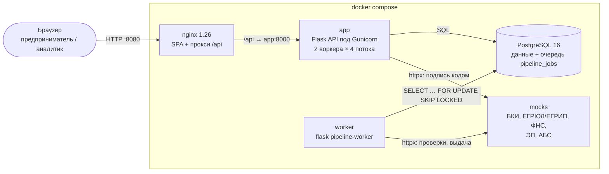
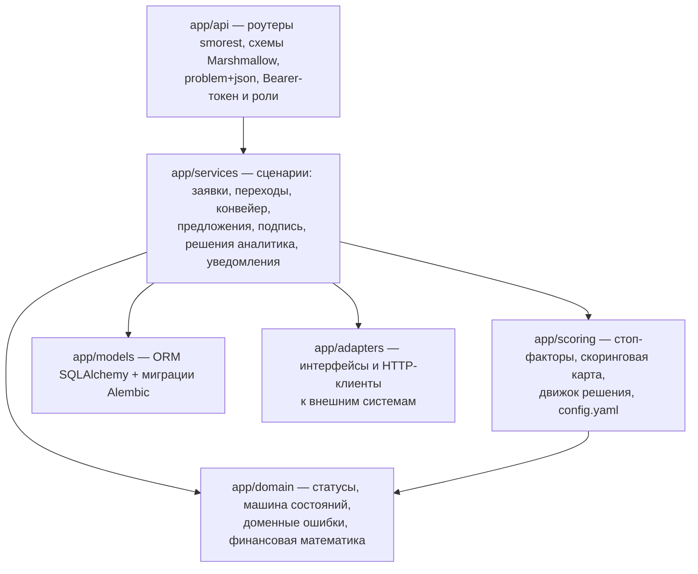
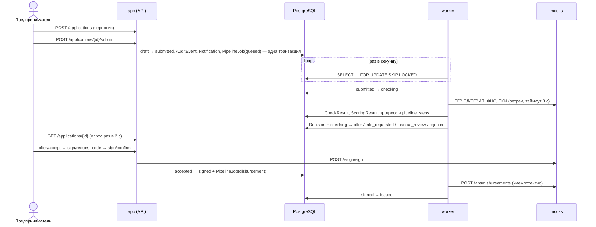

# Архитектура

Одно веб-приложение для двух ролей: предпринимателя и кредитного аналитика. Весь стек поднимается командой `docker compose up --build`. Внешние системы банка заменены моками в отдельном контейнере.

## Компоненты

| Сервис | Что делает | Зависит от |
| --- | --- | --- |
| `nginx` | отдаёт собранный SPA (React) и ассеты Swagger UI, проксирует `/api` в `app`. Фронт и API на одном домене, поэтому CORS не нужен | `app` healthy |
| `app` | REST API `/api/v1`, Swagger `/api/docs`. При старте применяет миграции и загружает сид в пустую БД | `db` healthy |
| `worker` | конвейер: проверки во внешних системах, скоринг, решение, выдача | `db`, `app` (миграции), `mocks` healthy |
| `db` | все данные и очередь задач конвейера | — |
| `mocks` | синтетические ответы внешних систем по ИНН, сбои по запросу | — |

У всех сервисов есть healthcheck.

## Слои backend

- В роутерах нет бизнес-логики: они разбирают запрос, вызывают сервис и сериализуют ответ.
- Скоринг и решение — чистые функции без БД и HTTP (`app/scoring/`), поэтому каждую ветку проверяют unit-тесты.
- Статус меняется только через `app/services/transitions.py`. Список разрешённых переходов — `app/domain/state_machine.py` (см. [`state-machine.md`](state-machine.md)).
- Внешние системы доступны только через адаптеры (`app/adapters/base.py`): httpx, таймаут 3 с, 2 ретрая с backoff, единая `AdapterError`.

## Поток заявки

Если внешняя система не ответила после ретраев, задача не падает: заявка уходит в `manual_review` с причиной `<источник>_unavailable`, и аналитик видит, какой шаг не прошёл.

## Надёжность конвейера

- **Очередь в БД.** Задача создаётся в одной транзакции со сменой статуса, поэтому заявка не может «потеряться» между API и воркером.
- **`SKIP LOCKED`.** Несколько воркеров не возьмут одну задачу.
- **Heartbeat.** Воркер обновляет `heartbeat_at` на каждом шаге. Задача без heartbeat дольше 60 с возвращается в очередь. Не больше 3 попыток, затем заявка уходит в `manual_review` (`pipeline_failed`).
- **Идемпотентные шаги.** Прогресс хранится в `pipeline_steps`. После рестарта задача продолжается с незавершённого шага, полученные проверки не запрашиваются повторно. Выдача в АБС идёт с `idempotency_key`.
- **Переживает рестарт.** Состояние целиком в PostgreSQL. Рестарт `worker` или `app` не теряет заявки.

## Безопасность и наблюдаемость

- Bearer-токен демо-входа подписан `itsdangerous`. Роли проверяет `@require_role`. Клиент видит только заявки своей компании.
- Ошибки отдаются в формате `application/problem+json` с `request_id`.
- JSON-логи с `request_id`: nginx передаёт `X-Request-ID`, приложение возвращает его в ответе. ИНН, ОГРН, телефоны и ФИО в логах маскируются (`app/log.py`).
- В nginx включены заголовки `X-Content-Type-Options`, `X-Frame-Options`, `Referrer-Policy`.
- Конфигурация задаётся через env (`DevConfig` / `TestConfig` / `ProdConfig`). Секретов в репозитории нет. `docker-compose.prod.yml` требует свой `SECRET_KEY`.

## Frontend

React 18 + TypeScript + Vite, React Router, TanStack Query, Mantine. Типы ответов генерируются из [`openapi.yaml`](openapi.yaml) (`npm run gen:api`). Пока заявка в `submitted`, `checking` или `signed`, карточка опрашивает API раз в 2 секунды. Статусы и подсказки «что происходит и что делать» живут в `frontend/src/shared/statuses.ts`.
