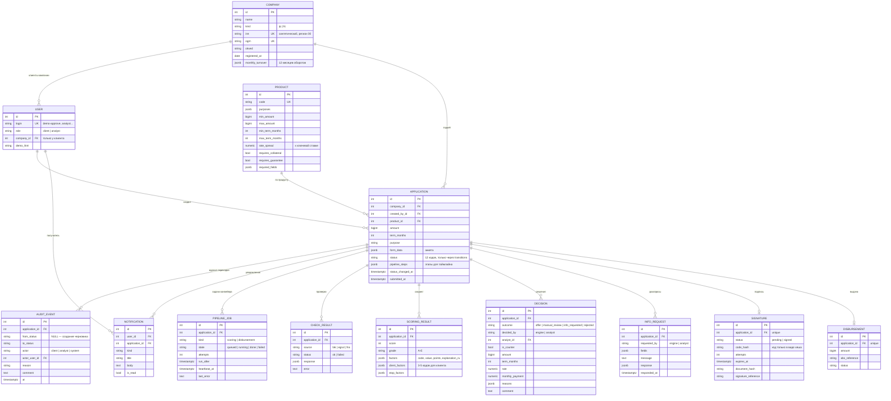

# Модель данных

PostgreSQL 16, схема создаётся миграциями Alembic (`migrations/versions/`), ORM — SQLAlchemy 2 (`app/models/`). Все данные синтетические.

## Ключевые ограничения

| Таблица | Ограничение | Зачем |
| --- | --- | --- |
| `applications` | `CHECK status IN (12 кодов)`, `amount > 0`, `term_months > 0` | только известные статусы |
| `applications.status` | у ORM-модели нет сеттера | статус меняется только через `services/transitions.py` |
| `users` | `CHECK (role = 'client') = (company_id IS NOT NULL)` | у клиента всегда есть компания, у аналитика нет |
| `pipeline_jobs` | частичный уникальный индекс `(application_id, kind) WHERE state = 'queued'` | повторная отправка не создаёт вторую задачу |
| `pipeline_jobs` | индекс `(state, run_after)` | быстрый выбор следующей задачи воркером |
| `check_results` | `UNIQUE (application_id, source)` | одна строка на источник, результаты переиспользуются |
| `signatures`, `disbursements` | `UNIQUE (application_id)` | одна подпись и одна выдача на заявку |
| `audit_events.actor` | `CHECK actor IN ('client', 'analyst', 'system')` | журнал только с известными акторами |

Актуальное решение по заявке — последняя строка `decisions` по `id`. Рекомендация движка для аналитика — последнее решение с `decided_by = 'engine'` и заполненной суммой.
