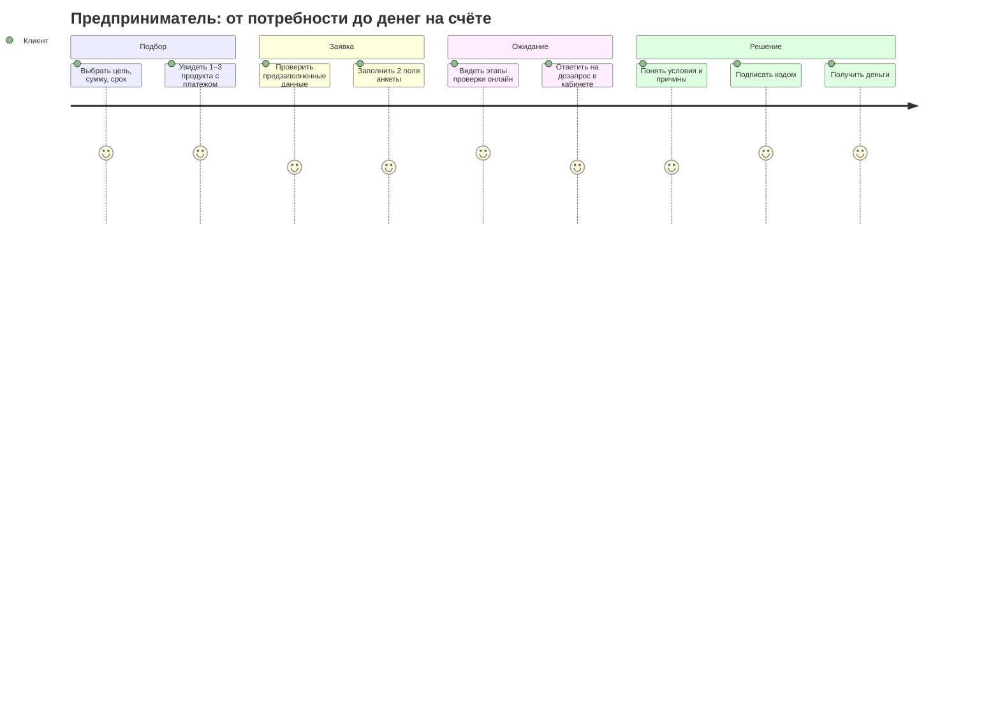

# Исследование: задачи пользователей и обоснование MVP

## Для кого

**Предприниматель малого или микробизнеса**, который уже обслуживается в банке: ИП или небольшое ООО, 5–50 сотрудников, оборот от сотен тысяч до нескольких миллионов рублей в месяц. Кредит ему нужен на оборотку, оборудование или кассовый разрыв. Финансового директора нет: заявку заполняет сам собственник между другими делами.

**Кредитный аналитик банка.** Он разбирает заявки, которые автоматика не смогла решить однозначно, и отвечает за качество решения.

## Jobs To Be Done

| Когда… | Я хочу… | Чтобы… |
| --- | --- | --- |
| мне срочно нужны деньги на закупку | понять за пару минут, какой кредит мне подходит и сколько я буду платить | не тратить время на продукты, которые мне не дадут |
| я подаю заявку | не вводить то, что банк обо мне уже знает | заявка заняла минуты, а не вечер |
| заявка на рассмотрении | видеть, что сейчас происходит и что от меня нужно | не звонить менеджеру и не гадать |
| банку чего-то не хватает | ответить прямо в кабинете | заявка не зависла на неделю |
| банк предложил меньше, чем я просил | понять почему и на каких условиях могу получить | принять осознанное решение |
| я согласен с условиями | подписать и получить деньги без визита в офис | деньги пришли сегодня |
| заявка пограничная (аналитик) | видеть все данные, проверки и рекомендацию в одной карточке | принять решение быстро и обоснованно |
| я меняю условия или отказываю (аналитик) | оставить комментарий, который увидит клиент и аудит | решение было прозрачным и проверяемым |

## Боли текущего процесса (гипотезы)

- Анкеты дублируют данные, которые у банка уже есть: реквизиты, обороты, руководитель.
- Статус заявки непрозрачен: «на рассмотрении» без сроков и без понятного следующего шага.
- Отказ или контрпредложение без объяснения воспринимаются как произвол.
- Дозапросы идут по почте и телефону, теряются, заявка зависает.
- Аналитик собирает данные из нескольких систем вручную.

## Путь пользователя в продукте

## Что вошло в MVP и почему

| Возможность | Зачем | Как сделано |
| --- | --- | --- |
| Демо-вход без регистрации | клиент уже клиент банка | выбор профиля, Bearer-токен |
| Подбор 1–3 продуктов с платежом | снять неопределённость до подачи | ставка «от» = ключевая + спред, аннуитет |
| Предзаполненная заявка и проверка полноты | минимум ручного ввода | данные компании из банка, 2 обязательных поля, подсказки по полям продукта |
| Трекер с этапами | прозрачность | `pipeline_steps`, опрос раз в 2 с, тексты «что происходит» |
| Дозапрос в продукте | заявка не зависает | `info_requested` → ответ в кабинете → автоматическая перепроверка |
| Объяснимое решение | доверие к решению | 3–5 факторов простыми словами, причины отказа и контрпредложения |
| Контрпредложение вместо отказа | клиент получает деньги, банк — приемлемый риск | лимит по оборотам и долговой нагрузке, более длинный срок |
| Подпись кодом и выдача | весь путь без офиса | симуляция ЭП и АБС, плашка «Симуляция» |
| Центр уведомлений | клиент знает о каждом изменении | уведомление на каждый переход, только в интерфейсе |
| Рабочее место аналитика | быстрые решения по пограничным заявкам | очередь, карточка со всеми факторами и рекомендацией, обязательный комментарий, журнал |

## Что сознательно не делаем

- Регистрацию: клиент уже клиент банка.
- Email, SMS и звонки: весь сценарий идёт внутри продукта.
- Мобильное приложение: условие трека — веб.
- Реальные интеграции с бюро и госреестрами: только моки, автономная поставка.
- Машинное обучение в скоринге: нужна объяснимость и воспроизводимость, правила лежат в `config.yaml`.
- Посткредитное обслуживание и новостную ленту: вне скоупа кейса.

## Как измерять успех (для пилота)

- Доля заявок, решённых автоматически без аналитика.
- Время от подачи до решения: в прототипе секунды, с ручным рассмотрением минуты.
- Доля дозапросов, на которые ответили в течение суток.
- Конверсия «предложение → подпись», отдельно для контрпредложений.
- Время аналитика на одну заявку.
