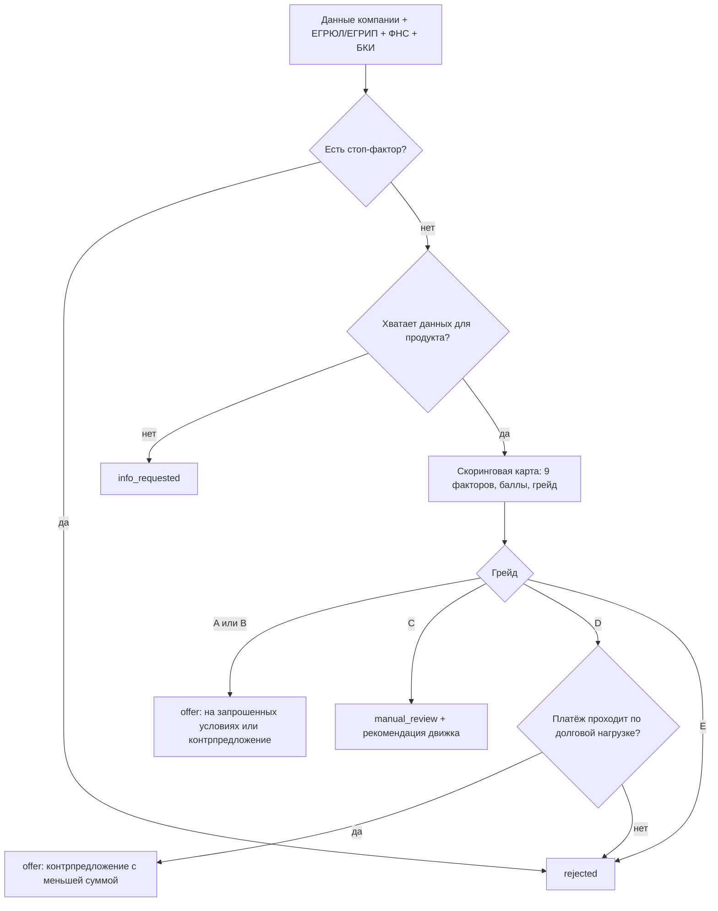

# Скоринг и кредитное решение

Решение принимается по детерминированным правилам, машинного обучения нет. Код лежит в `app/scoring/` (`stop_factors.py`, `scorecard.py`, `decision_engine.py`), все веса и пороги — в `app/scoring/config.yaml`. Скоринг даёт оценку риска, а итог и условия определяет `decision_engine.py` с учётом продукта, суммы, срока и долговой нагрузки.

Логика не заточена под демо-компании: тест `test_random_profiles_always_get_consistent_decisions` прогоняет 300 случайных синтетических профилей и проверяет, что решение всегда корректно.

## Порядок решения



## 1. Стоп-факторы → `rejected`

| Код | Условие | Порог в конфиге |
| --- | --- | --- |
| `company_inactive` | статус по ЕГРЮЛ/ЕГРИП: ликвидация или банкротство | `inactive_company_statuses` |
| `current_overdue` | текущая просрочка в БКИ больше 90 дней | `max_current_overdue_days: 90` |
| `tax_debt` | налоговая задолженность больше порога | `max_tax_debt: 100000` |
| `business_too_young` | бизнесу меньше 6 полных месяцев (дата регистрации из ЕГРЮЛ/ЕГРИП) | `min_business_age_months: 6` |

Клиент видит все сработавшие стоп-факторы. Стоп-фактор важнее неполных данных: дозапрос не отправляется, если отказ неизбежен.

## 2. Неполные данные → `info_requested`

Обязательные поля продукта — это `required_fields`. К ним добавляются поля залога (`collateral_description`, `collateral_value`), если продукт требует залог, и поля поручителя (`guarantor_full_name`, `guarantor_inn`), если нужно поручительство. Незаполненные поля уходят в дозапрос клиенту с понятными подписями из `app/domain/form_fields.py`.

## 3. Скоринговая карта

Сумма баллов по девяти факторам, максимум 330. Каждый фактор возвращает баллы и объяснение на русском (`explanation_ru`).

| Фактор (`code`) | Показатель | Баллы | Макс. |
| --- | --- | --- | --- |
| `business_age` | возраст бизнеса, полных месяцев | <12 → 0; 12–23 → 10; 24–35 → 20; 36–59 → 30; ≥60 → 40 | 40 |
| `avg_turnover` | среднемесячный оборот по счёту за 12 мес., ₽ | <300 тыс. → 0; до 1 млн → 10; до 3 млн → 25; до 10 млн → 40; ≥10 млн → 50 | 50 |
| `turnover_stability` | коэффициент вариации оборотов (σ / среднее) | ≤0,10 → 40; ≤0,20 → 30; ≤0,35 → 15; ≤0,50 → 5; больше → 0 | 40 |
| `debt_load` | платежи по текущим кредитам (БКИ) / среднемесячный оборот | ≤5% → 40; ≤15% → 30; ≤30% → 15; ≤45% → 0; больше → −20 | 40 |
| `credit_history` | БКИ за 24 мес.: максимальная просрочка и число случаев | нет просрочек → 50; до 30 дн. и не больше 2 случаев → 30; до 60 дн. → 10; дольше или текущая просрочка → −20 | 50 |
| `tax_discipline` | ФНС: опоздания с уплатой налогов за 12 мес. | 0 → 30; 1–2 → 15; 3 и больше → 0; задолженность ниже порога стоп-фактора → ещё −10 | 30 |
| `amount_to_turnover` | запрошенная сумма / годовой оборот | ≤10% → 30; ≤25% → 20; ≤50% → 5; больше → −15 | 30 |
| `security` | залог и (или) поручительство в анкете | залог → 25; поручитель → 15; оба → 30; нет → 0 | 30 |
| `industry_risk` | класс ОКВЭД (первые две цифры) | низкий риск → 20; средний (остальные) → 10; повышенный → 0 | 20 |

Отраслевые классы. Низкий риск: 10, 11, 13, 14, 16, 22, 25–29, 31, 46, 47, 62, 63, 69–72, 85, 86. Повышенный риск: 41–43 (строительство), 55, 56 (гостиницы и общепит), 68, 77, 92, 93.

### Грейды

| Грейд | Сумма баллов |
| --- | --- |
| A | ≥ 250 |
| B | 200–249 |
| C | 140–199 |
| D | 100–139 |
| E | < 100 |

## 4. Решение по грейду

| Грейд | Исход |
| --- | --- |
| A, B | сумма ≤ лимита → `offer` на запрошенных условиях. Иначе `offer` с `is_counter=true`: сначала та же сумма на более длинный срок (до максимального срока продукта), если и так не проходит — сумма = лимит |
| C | `manual_review`; аналитику передаётся рекомендация движка (условия, которые дал бы алгоритм A/B с коэффициентами грейда C) |
| D | контрпредложение: min(50% запрошенной суммы, лимит) на запрошенный срок. Если сумма меньше минимума продукта, `rejected` (`debt_load_exceeded` или `limit_below_minimum`) |
| E | `rejected` (`low_score`) |

Если у A/B лимит меньше минимальной суммы продукта, заявка получает `rejected` (`limit_below_minimum`).

## 5. Лимит

```
avg         = среднемесячный оборот за 12 месяцев
max_payment = 0,25 × avg − текущие платежи по кредитам (БКИ)
L(t)        = min( макс. сумма продукта,
                   k(грейд) × avg × min(t, 36) / 12,
                   P_max(max_payment, t, ставка) )
```

Результат округляется вниз до 10 000 ₽. `P_max` — наибольшая сумма, аннуитетный платёж по которой не больше `max_payment`:

```
P_max = M × ((1 + r)^n − 1) / (r × (1 + r)^n),   r = ставка / 12 / 100,   n = t
```

| Параметр | A | B | C | D |
| --- | --- | --- | --- | --- |
| k(грейд) | 3,0 | 2,0 | 1,5 | 1,0 |

Ограничение по долговой нагрузке встроено в лимит: у любого предложения (текущие платежи + новый платёж) / оборот ≤ 25%.

## 6. Ставка и платёж

```
ставка = KEY_RATE + спред продукта + надбавка за грейд
```

- `KEY_RATE` задаётся в env, по умолчанию 14,0 (ключевая ставка ЦБ на 23.10.2026).
- Надбавка за грейд: A — 0; B — 1,5; C — 3,0; D — 5,0 п. п.
- Спреды продуктов (`seed/products.json`): оборотный «Ритм» — 4,5; инвестиционный «Станок» — 3,0 (залог); экспресс «Быстрый старт» — 7,5; кредитная линия «Запас» — 5,0.

При ключевой ставке 14% ставки лежат в диапазоне от 17% («Станок», грейд A) до 26,5% («Быстрый старт», грейд D). Это рыночный уровень для кредитов малому бизнесу.

Платёж аннуитетный: `платёж = S × r × (1 + r)^n / ((1 + r)^n − 1)`. График строит `app/domain/loan_math.py`; копейки округления уходят в последний платёж, поэтому сумма погашений равна сумме кредита.

## 7. Объяснимость

- Клиент видит 3–5 главных факторов простыми словами: сначала то, что снизило оценку, затем сильные стороны (`client_factors`). При отказе по стоп-фактору он видит причину отказа.
- Аналитик видит все девять факторов с баллами, сработавшие стоп-факторы и рекомендацию движка.

## Калибровка демо-сценариев

Расчёт на 23.10.2026, `KEY_RATE = 14,0`. Входные данные: `seed/demo_companies.json` и `mocks/data/*.json`. Проверяется тестом `tests/unit/test_demo_scenarios.py`.

| Профиль | Заявка | Баллы | Грейд | Итог |
| --- | --- | --- | --- | --- |
| `demo-approve` | «Ритм», 3 000 000 ₽, 24 мес. | 290 | A | `offer`: 3 000 000 ₽ на 24 мес., 18,5%, платёж 150 498,08 ₽ |
| `demo-counter` | «Ритм», 12 000 000 ₽, 24 мес. | 230 | B | `offer`, контрпредложение: 9 910 000 ₽ на 36 мес., 20,0%, платёж 368 291,11 ₽ |
| `demo-info` | «Станок», 2 500 000 ₽, 36 мес., без данных о залоге | — | — | `info_requested`: описание и стоимость залога, поставщик |
| `demo-info` после ответа | те же условия + залог | 290 | A | `offer`: 2 500 000 ₽ на 36 мес., 17,0%, платёж 89 131,82 ₽ |
| `demo-manual` | «Быстрый старт», 1 500 000 ₽, 18 мес. | 150 | C | `manual_review`; рекомендация: 1 500 000 ₽, 24,5% |
| `demo-reject` | «Ритм», 2 000 000 ₽, 12 мес. | — | — | `rejected`: текущая просрочка 120 дней |

## Тесты

| Файл | Что проверяет |
| --- | --- |
| `tests/unit/test_stop_factors.py` | каждый стоп-фактор и его границы |
| `tests/unit/test_scorecard.py` | полосы всех 9 факторов, пороги грейдов, выбор 3–5 факторов для клиента |
| `tests/unit/test_decision_engine.py` | каждую ветку решения, ставку по грейду, долговую нагрузку, 300 случайных профилей |
| `tests/unit/test_loan_math.py` | аннуитет, обратный расчёт суммы, график платежей |
| `tests/unit/test_demo_scenarios.py` | пять демо-сценариев |
