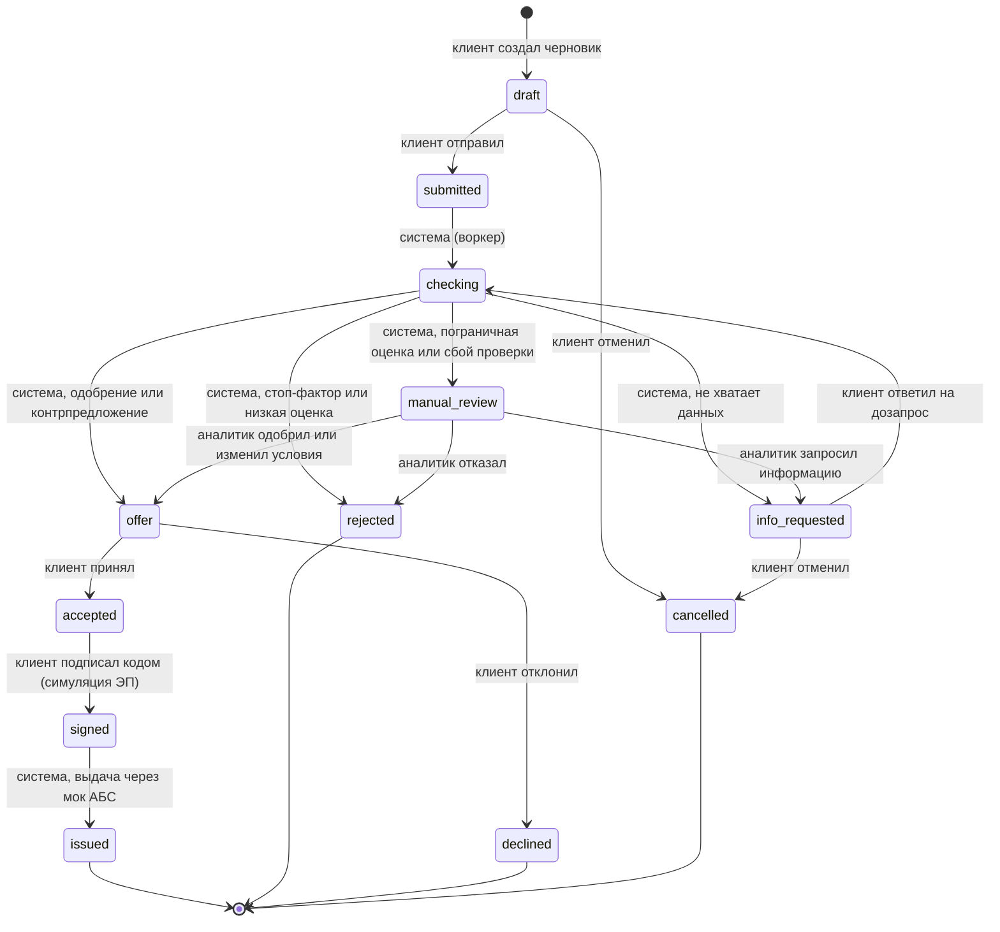

# Машина состояний заявки

Разрешённые переходы описаны в одном месте — `app/domain/state_machine.py`. Сменить статус можно только через `app/services/transitions.py`. У модели `Application` нет сеттера `status`: прямое присваивание поднимает `AttributeError`.

## Диаграмма

## Статусы

Коды одинаковые в БД, API, UI и документации. Русские подписи живут только в UI-словаре `frontend/src/shared/statuses.ts`.

| Код | Подпись в UI | Кто переводит дальше |
| --- | --- | --- |
| `draft` | Черновик | клиент |
| `submitted` | Подана | система |
| `checking` | Проверка и скоринг | система |
| `info_requested` | Нужна информация | клиент |
| `manual_review` | Ручное рассмотрение | аналитик |
| `offer` | Предложение | клиент |
| `accepted` | Принято | клиент (подпись) |
| `signed` | Подписано | система (выдача) |
| `issued` | Выдано | — |
| `rejected` | Отказ | — |
| `declined` | Отклонено клиентом | — |
| `cancelled` | Отменена клиентом | — |

Терминальные статусы: `issued`, `rejected`, `declined`, `cancelled`. Из них переходов нет.

## Переходы

| Из | В | Актор | Комментарий обязателен |
| --- | --- | --- | --- |
| `draft` | `submitted` | client | нет |
| `draft` | `cancelled` | client | нет |
| `submitted` | `checking` | system | нет |
| `checking` | `info_requested` | system | нет |
| `checking` | `manual_review` | system | нет |
| `checking` | `offer` | system | нет |
| `checking` | `rejected` | system | нет |
| `info_requested` | `checking` | client | нет |
| `info_requested` | `cancelled` | client | нет |
| `manual_review` | `offer` | analyst | да |
| `manual_review` | `rejected` | analyst | да |
| `manual_review` | `info_requested` | analyst | да |
| `offer` | `accepted` | client | нет |
| `offer` | `declined` | client | нет |
| `accepted` | `signed` | client | нет |
| `signed` | `issued` | system | нет |

Все остальные пары статусов запрещены. Разрешённый переход, который пытается выполнить другой актор, тоже запрещён.

## Правила

- **Недопустимый переход** → `InvalidTransition` → HTTP 409, `application/problem+json`, `code: invalid_transition`.
- **Решение аналитика без комментария** → `CommentRequired` → HTTP 422, `code: comment_required`.
- **Повтор перехода в текущий статус** идемпотентен: ничего не пишется, API возвращает 200 с текущим состоянием.
- **Каждый переход в одной транзакции** меняет статус и `status_changed_at`, пишет `AuditEvent` (`from_status`, `to_status`, `actor`, `actor_user_id`, `reason`, `comment`, `at`) и `Notification` клиенту. Коммит делает вызывающий сервис, поэтому смена статуса и постановка задачи в очередь конвейера атомарны.
- **Параллельные переходы**: на время перехода строка заявки блокируется (`SELECT … FOR UPDATE`).

## Тесты

- `tests/unit/test_state_machine.py` проверяет 16 разрешённых переходов с актором и то, что все остальные пары запрещены для каждого актора. Там же обязательный комментарий аналитика и терминальные статусы.
- `tests/unit/test_transitions.py` проверяет аудит и уведомление, идемпотентный повтор, откат транзакции и запрет прямого присваивания статуса.
- `tests/api/test_errors.py` проверяет, что доменные ошибки отдаются как problem+json с кодами 409 и 422.
